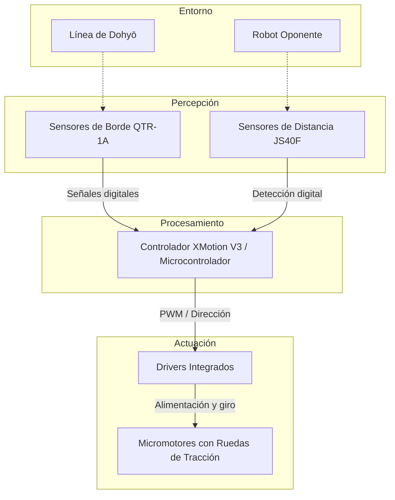

## Misión y arquitectura del equipo

**Plataforma:** M01 Mini-sumo autónomo[cite: 1]  
**Propósito real y escenario:** Diseñar, ensamblar y programar un robot mini-sumo autónomo capaz de competir en un dohyō reglamentario, localizando al oponente y expulsándolo del área de combate sin salirse de la pista[cite: 1, 2, 3].

### Objetivo verificable del robot

Diseñar y poner en marcha un mini-sumo autónomo de hasta 500 g y 10x10 cm que opere de manera independiente sobre un dohyō estándar, ejecutando una rutina de búsqueda y ataque hacia el oponente mediante sensores infrarrojos JS40F, manteniendo una tasa de evasión de borde del 100% mediante sensores de reflectancia QTR-1A.

---

### Arquitectura de alto nivel

| Subsistema | Función | Entradas | Salidas | Responsable / alcance |
| :--- | :--- | :--- | :--- | :--- |
| **Mecánica** | Soporte estructural, protección y tracción | Impactos, par motor | Movimiento en pista | Polo / Chasis y ensamble general |
| **Sensores** | Detección de borde (línea blanca) y oponente | Luz reflejada / Rebote IR | Señales lógicas digitales | Erik / MS05 (Sensores de borde)[cite: 2] |
| **Control** | Procesamiento de lógica de combate y estados | Lecturas de sensores | Señales PWM y dirección a drivers | Polo y Erik / Lógica de control |
| **Actuadores** | Generación de tracción y empuje | PWM y dirección de la placa | Rotación de ruedas | Erik / MS03 (Motorización y tracción)[cite: 2, 3] |
| **Software/Firmware** | Máquina de estados, evasión y ataque | Entradas de sensores | Control de motores | Erik / MS11 (Recuperación y evasión) |

---

### Diagrama

---

### Dependencias críticas
Disponibilidad de componentes y herramientas: Placa controladora XMotion V3, 2 micromotores con llantas de alto agarre, sensores JS40F, sensores QTR-1A, batería LiPo, cautín, soldadura, multímetro e impresora 3D.

Software y versiones: Arduino IDE (v2.x) o entorno C++, controladores USB de la placa y Git/GitHub para control de versiones.

Condiciones de arena/pista: Dohyō reglamentario de mini-sumo (superficie negra mate de 77 cm de diámetro con borde blanco de 2.5 cm)[cite: 2, 3], libre de polvo para asegurar adherencia de tracción.

### Interfaces entre alcancesMecánica y Sensores: 
El chasis debe proveer soportes frontales a la altura adecuada para los sensores de distancia JS40F y hendiduras inferiores para los sensores QTR-1A a una distancia de 2 a 4 mm del suelo.Sensores y Software: Definición de pines y umbrales digitales; las lecturas de los sensores de línea tienen prioridad máxima de interrupción/evaluación sobre los sensores de búsqueda.   Control y Tracción: Definición compartida de valores de PWM para asegurar que los giros de búsqueda no generen deslizamiento excesivo y que la rutina de reversa responda 
